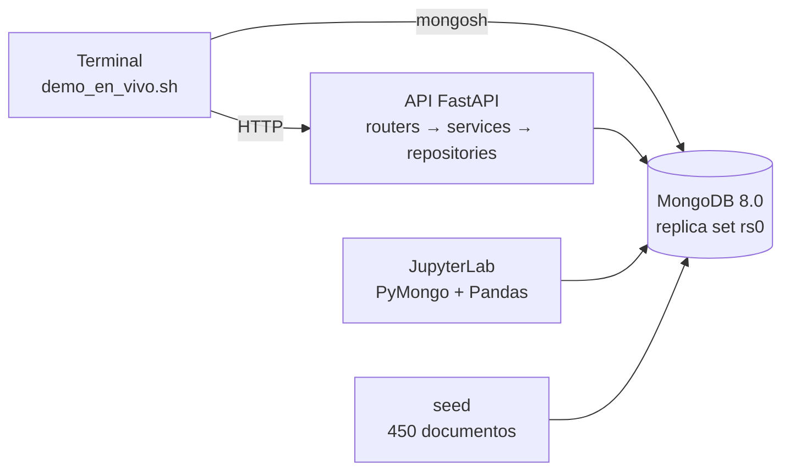

# Guía de la demo en vivo: el proyecto explicado paso a paso

Esta guía sirve para presentar **todo el proyecto usando solamente la demo en vivo**. Sirve si el profesor pide ver la demo sin la presentación, y también como guion de la demo dentro de la presentación completa.

Para cada paso de [`demo/demo_en_vivo.sh`](demo/demo_en_vivo.sh) hay cuatro partes:

- **Qué aparece:** la salida real del script. Los datos se generan siempre iguales, así que se ve lo mismo en cualquier computadora.
- **Qué decir:** un texto para explicarlo con nuestras palabras. No hace falta leerlo literal.
- **Qué demuestra:** el requisito de la consigna que cubre.
- **Si preguntan:** las preguntas más probables sobre ese paso.

Duración: unos **12 minutos** sin preguntas.

La preparación general, el reparto de la presentación y las fichas para la defensa individual están en [`../defensa.md`](../defensa.md).

---

## 0. El proyecto en un minuto

Si la demo es lo único que se muestra, hay que empezar por acá, antes de ejecutar nada.

> Hicimos la base de datos de una **plataforma de empleos estilo LinkedIn**. Los candidatos publican su perfil, las empresas publican ofertas y los candidatos se postulan. Elegimos MongoDB porque los perfiles son muy distintos entre sí, tienen muchos campos opcionales y se leen siempre completos: en una base documental, un perfil es un solo documento y una sola lectura.
>
> El modelo tiene **cuatro colecciones**: `usuarios` (la entidad principal), `empresas`, `ofertas` y `postulaciones`. Sobre la base construimos una **API** con una capa de repositorios, resolvimos un **caso de consistencia** con transacciones y analizamos los datos en **JupyterLab**. Todo corre con **Docker Compose**.
>
> La demo recorre esas partes en orden: el modelo, la validación, una consulta, un índice, la transacción por la API, los tests y, al final, Swagger y el análisis.



| Componente | Qué es |
| :--- | :--- |
| `mongo` | MongoDB 8.0 como replica set de un nodo, porque las transacciones lo requieren |
| `api` | FastAPI + PyMongo en <http://localhost:8000> |
| `seed` | Generador de los 450 documentos de prueba (siempre los mismos, por la semilla fija) |
| `analisis` | JupyterLab con el notebook de análisis en <http://localhost:8888> |

---

## Antes de empezar

1. Abrir **Docker Desktop** y esperar a que esté funcionando.
2. Abrir una terminal en la carpeta del proyecto: **Terminal** en Mac, **Git Bash** en Windows.
3. Aumentar el tamaño de letra de la terminal, para que se lea desde lejos.
4. Ejecutar:

```bash
docs/PRESENTACION/demo/demo_en_vivo.sh
```

Cada paso espera un **Enter**. Conviene explicar mientras se ve la salida y avanzar recién al terminar.

Para ensayarla antes, sin pausas: `DEMO_SIN_PAUSAS=1 docs/PRESENTACION/demo/demo_en_vivo.sh`.

---

## Preparación (automática, ≈ 20 segundos)

**Qué aparece:**

```
$ bin/reset_db.sh
==> Levantando MongoDB
==> Creando colecciones y validaciones
==> Cargando datos de prueba
==> Creando índices
==> Verificando la carga
Verificación completa: sin errores.
$ docker compose up -d --build --wait api
→ API en http://localhost:8000 → {"estado":"ok"}
```

**Qué decir:**

> Este script deja la base siempre en el mismo estado: la borra, crea las colecciones con sus reglas de validación, carga 450 documentos de prueba, crea los índices y verifica que todo sea consistente. Los datos se generan con una semilla fija, así que cualquiera que clone el repositorio obtiene exactamente la misma base. Después levantamos la API.

**Qué demuestra:** carga reproducible (5.2), entorno con Docker Compose (5.8) y verificación de la consistencia de los datos.

**Si preguntan qué verifica:** que cada oferta y cada postulación apunten a documentos que existen, que las vacantes disponibles coincidan con las postulaciones aceptadas, que los contadores coincidan, que las fechas tengan sentido, y que el validador rechace 7 documentos inválidos de prueba.

---

## Paso 1. Modelo documental (≈ 2 minutos)

**Qué aparece:** primero, un usuario completo:

```
{
  _id: ObjectId('65d18d27ce3714af99b49350'),
  nombre: 'Delfina', apellido: 'Nuñez',
  seniority: 'senior',
  ubicacion: { ciudad: 'Mendoza', provincia: 'Mendoza', pais: 'Argentina' },
  skills: [ 'docker', 'kubernetes', 'aws', 'azure', 'ci/cd', 'git' ],
  experiencia: [
    { empresaId: null, empresaNombre: 'Municipalidad de Córdoba', puesto: 'DevOps Engineer Jr', ... actual: false },
    ...
    { empresaId: ObjectId('658d8e77...'), empresaNombre: 'Algarrobo Agrotech', puesto: 'DevOps Engineer Sr',
      hasta: null, actual: true }
  ],
  educacion: [ ... ], idiomas: [ { idioma: 'inglés', nivel: 'C1' } ],
  certificaciones: [ { nombre: 'AWS Certified Cloud Practitioner', ... } ],
  contacto: { telefono: '+54 9 261 638-8136' }
}
```

Después, una postulación aceptada con su historial:

```
{
  usuarioId: ObjectId('682347ec...'), ofertaId: ObjectId('69d867b0...'), empresaId: ObjectId('675db3f3...'),
  estado: 'aceptada', coincidenciaSkills: 0.75,
  historialEstados: [ { estado: 'enviada', ... }, { estado: 'en_revision', ... },
                      { estado: 'entrevista', nota: 'Entrevista con RR. HH.' }, { estado: 'aceptada', ... } ]
}
→ usuarioId y ofertaId son referencias; historialEstados está embebido
```

**Qué decir:**

> Este es un perfil completo: una sola lectura trae todo. La experiencia, la educación, las skills y las certificaciones están **embebidas**, porque son pocos elementos, se muestran siempre junto con el perfil y no existen sin el usuario. Esta persona no tiene `preferencias`: el campo simplemente no está, no hace falta un NULL.
>
> Fíjense que cada trabajo puede tener un `empresaId`, si la empresa está registrada en la plataforma, o solo el nombre, si no lo está. Es una referencia opcional.
>
> La postulación es distinta: está en su **propia colección** y referencia al usuario y a la oferta. No la embebimos en la oferta porque una oferta popular puede recibir cientos de postulaciones: el documento crecería sin límite. Lo que sí embebimos es su **historial de estados**, que son pocos elementos y siempre se leen con la postulación.

**Qué demuestra:** diseño documental y justificación (5.1): documentos anidados, arreglos, campos opcionales y la decisión entre embeber y referenciar.

**Si preguntan:**
- *¿Por qué `empresaId` aparece junto con `empresaNombre`?* Es una desnormalización controlada: permite mostrar el nombre sin consultar otra colección. Cuando se indica `empresaId`, la API copia el nombre desde la colección `empresas`.
- *¿Y `coincidenciaSkills`?* Es el porcentaje de skills requeridas por la oferta que tenía el candidato al postularse. Se calcula una vez, se guarda y después se usa para ordenar postulantes y en el análisis.

---

## Paso 2. Validación en la base (≈ 1 minuto)

**Qué aparece:**

```
$ db.ofertas.insertOne({ ..., vacantes: { total: 1, disponibles: 3 } })
Rechazado por el validador: código 121 (Document failed validation)
→ Regla entre campos: vacantes.disponibles no puede superar a vacantes.total
```

**Qué decir:**

> MongoDB no obliga a tener un esquema, pero nosotros definimos uno. Cada colección tiene un validador con `$jsonSchema` (campos obligatorios, tipos, valores permitidos) y además reglas entre campos. Acá intentamos guardar una oferta con 3 vacantes disponibles sobre un total de 1, y la base la rechaza con el código 121. Esto es la última barrera: aunque la API tuviera un error, la base no acepta datos inválidos.

**Qué demuestra:** validaciones (5.2 y 5.4) y la extensión opcional de validación de esquemas.

**Si preguntan qué otras reglas hay:** el salario mínimo no puede superar al máximo, una oferta que no es remota tiene que tener ubicación, las skills no se pueden repetir, el email tiene que tener formato válido y los arreglos embebidos tienen un tamaño máximo (por ejemplo, 30 experiencias como máximo).

---

## Paso 3. Consulta sobre arreglos (≈ 1 minuto)

**Qué aparece:**

```
Victoria Diaz | sql, aws, docker, redis, python, go, git | trabaja en Algarrobo Agrotech
Catalina Gomez | docker, sql, mongodb, node.js, postgresql, python, java, ... | trabaja en Puna Studio
Francisco Garcia | sql, power bi, tableau, python, airflow, excel, git, jira | trabaja en Aula Viva
... 10 usuarios en total
```

**Qué decir:**

> Buscamos a quienes saben Python **y** SQL y trabajan hoy en una empresa registrada. Hay dos operadores sobre arreglos. `$all` pide que el arreglo de skills tenga los dos valores. `$elemMatch` pide que **un mismo trabajo** cumpla las dos condiciones a la vez: que sea el actual y que la empresa esté registrada. Sin `$elemMatch`, un trabajo viejo en una empresa registrada y un freelance actual cumplirían el filtro entre los dos, y el resultado estaría mal. En la proyección usamos `$elemMatch` otra vez, para mostrar solo ese trabajo y no toda la trayectoria.

**Qué demuestra:** consultas sobre arreglos y atributos anidados (5.3). Es la consulta 5 de las 13 que tenemos.

**Si preguntan por las otras consultas:** están en `db/scripts/04_consultas.js` y se ejecutan con `bin/mongosh.sh /scripts/04_consultas.js`. Ver "Si piden ver más" al final de esta guía.

---

## Paso 4. Índices con explain() (≈ 1,5 minutos)

**Qué aparece:**

```
con índice  FETCH <- IXSCAN[ix_busqueda_ofertas]       devueltos: 3 | documentos examinados: 3
sin índice  SORT <- COLLSCAN                           devueltos: 3 | documentos examinados: 60
→ Con índice examina 3 documentos para devolver 3, y sin ordenar en memoria (no hay SORT)
```

**Qué decir:**

> Esta es la búsqueda principal de ofertas: abiertas, semi-senior, en pesos y con un salario mínimo de al menos 1,7 millones. La ejecutamos dos veces: con el índice y forzando a MongoDB a no usarlo.
>
> Con el índice compuesto examina exactamente 3 documentos para devolver 3. Sin índice recorre las 60 ofertas (`COLLSCAN`) y además tiene que ordenar en memoria (`SORT`).
>
> El índice sigue la regla **ESR**: primero los campos que se comparan por igualdad (estado, seniority, moneda) y al final el de rango (el salario). Por eso acota justo las claves necesarias y los resultados ya salen ordenados.

**Qué demuestra:** índices y análisis de rendimiento con `explain("executionStats")` (5.5).

**Si preguntan:**
- *¿Cuánto más rápido es?* Con 450 documentos las dos versiones tardan 0 ms, porque todo entra en memoria. Por eso medimos documentos examinados contra documentos devueltos: sin índice, ese número crece con el tamaño de la colección.
- *¿Los índices tienen costo?* Sí: en `ofertas` ocupan más espacio que los datos y cada escritura los actualiza. Por eso decidimos no crear dos índices más cuyo beneficio no se justificaba con este volumen.

---

## Paso 5. Aceptar a un candidato: API y transacción (≈ 3 minutos)

Es el momento central de la demo: muestra la API y el caso de consistencia.

### 5a. La oferta y sus postulantes

**Qué aparece:**

```
$ GET /ofertas/6aacc5503c4722f3c1b4fd44
Desarrollador/a Mobile Sr · Brújula Fintech
estado: abierta | vacantes: {'total': 1, 'disponibles': 1} | postulaciones: 9
$ GET /ofertas/6aacc5503c4722f3c1b4fd44/postulaciones   (activas, mayor coincidencia primero)
  6adb7a8c6f144dc6b9ede33f entrevista 1.0
  6ac66cd24580a4ae9b72a9fe enviada 1.0
  6ac4e770283edeec92455468 enviada 1.0
```

**Qué decir:**

> Ahora usamos la API, como lo haría la aplicación. Esta oferta tiene **una sola vacante** y nueve postulantes activos, ordenados por coincidencia de skills. Vamos a aceptar a dos candidatos para la misma vacante. El primero tiene que entrar y el segundo no.

### 5b. Se acepta al primer candidato

**Qué aparece:**

```
$ PATCH /postulaciones/6adb7a8c6f144dc6b9ede33f/estado  {"estado": "aceptada"}
→ HTTP 200
estado: aceptada | historial: enviada → en_revision → entrevista → aceptada
$ GET /ofertas/6aacc5503c4722f3c1b4fd44
estado: cerrada | vacantes: {'total': 1, 'disponibles': 0} | fechaCierre: 2026-...
→ La transacción descontó la vacante y, como era la última, cerró la oferta
```

**Qué decir:**

> Aceptar a un candidato son **tres escrituras en dos colecciones**:
> 1. La postulación pasa a "aceptada".
> 2. La oferta descuenta una vacante.
> 3. Como era la última, la oferta se cierra.
>
> Si se hiciera solo una parte (por ejemplo, si se cae el servidor entre el paso 1 y el 2), quedaría una contratación registrada sin descontar la vacante. Por eso las tres escrituras van en una **transacción multidocumento**: o se aplican todas o ninguna.

### 5c. El segundo candidato recibe 409

**Qué aparece:**

```
→ PATCH /postulaciones/6ac66cd24580a4ae9b72a9fe/estado {"estado": "en_revision"} → 200
→ PATCH /postulaciones/6ac66cd24580a4ae9b72a9fe/estado {"estado": "entrevista"} → 200
$ PATCH /postulaciones/6ac66cd24580a4ae9b72a9fe/estado  {"estado": "aceptada"}
→ HTTP 409
{"error": "conflicto", "detalle": "La oferta no está abierta o ya no tiene vacantes disponibles"}
la postulación sigue en: entrevista
→ El paso 1 (pasar a aceptada) se deshizo: la transacción se abortó por completo
```

**Qué decir:**

> Llevamos al segundo candidato hasta la entrevista. La API controla las transiciones: no se puede saltar de "enviada" a "aceptada". Después intentamos aceptarlo.
>
> Dentro de la transacción pasa esto: el paso 1 sí se ejecuta y la postulación pasa a "aceptada". Pero el paso 2 descuenta la vacante **solo si queda alguna**: la condición y el descuento van en la misma operación atómica. Como no quedan vacantes, la API lanza un conflicto, la transacción se aborta y MongoDB **deshace el paso 1**. Por eso la postulación sigue en "entrevista". Respondemos 409, que significa que la operación es válida pero choca con el estado actual de los datos.

**Qué demuestra:**
- API con capa de repositorios (5.4): validación, códigos HTTP y mensajes de error.
- Consistencia y transacciones (5.6).

**Si preguntan:**
- *¿Por qué una transacción y no una operación atómica?* Porque modifica documentos de dos colecciones distintas. Cuando la operación toca un solo documento, como pasar a "entrevista", usamos una operación atómica sin transacción.
- *¿Por qué MongoDB corre como replica set si es un solo servidor?* Porque las transacciones multidocumento no funcionan en una instancia independiente.
- *¿Cómo está armada la API?* En tres capas. Los routers reciben la petición HTTP y validan los datos con Pydantic. Los servicios aplican las reglas de negocio y abren la transacción. Los repositorios son el único lugar que habla con MongoDB, y cada uno de sus métodos recibe la sesión de la transacción.

---

## Paso 6. Tests de consistencia (≈ 1 minuto)

**Qué aparece:**

```
tests/test_postulaciones.py::test_aceptar_sin_vacantes_devuelve_409_y_deshace_el_cambio_de_la_postulacion PASSED
tests/test_postulaciones.py::test_falla_a_mitad_de_la_transaccion_no_deja_cambios_parciales PASSED
tests/test_postulaciones.py::test_aceptaciones_simultaneas_no_superan_las_vacantes PASSED
======================= 3 passed, 40 deselected in 0.23s =======================
```

**Qué decir:**

> Lo que acabamos de ver a mano también está probado automáticamente. Tenemos 43 tests de integración contra MongoDB real, y estos son los tres de consistencia:
> - **Sin vacantes:** es el mismo caso que acabamos de ver.
> - **Falla a mitad de camino:** forzamos un error después de dos de las tres escrituras, y la base queda idéntica a como estaba.
> - **Concurrencia:** cinco reclutadores aceptan al mismo tiempo a cinco candidatos para una sola vacante, y se acepta exactamente uno.
>
> En la concurrencia, las transacciones chocan porque modifican la misma oferta. MongoDB aborta las perdedoras, `with_transaction` las reintenta y en el reintento ya no hay vacante.

**Qué demuestra:** prueba del comportamiento ante errores (5.6), pruebas verificables (sección 8 de la consigna) y las extensiones opcionales de pruebas de integración y de concurrencia.

**Si preguntan cómo se corren todos:** `docker compose run --rm api pytest`. Usan una base aparte, `empleos_test`, que copia los validadores e índices reales, así que no tocan los datos del proyecto.

---

## Paso 7. Swagger y JupyterLab (≈ 2,5 minutos)

El script abre las dos páginas en el navegador.

### Swagger: <http://localhost:8000/docs>

Mostrar rápido el CRUD de la entidad principal:

1. **`GET /usuarios`**: *Try it out*, poner `skill = python` y `seniority = senior`, y *Execute*. Se ve el listado paginado, con un resumen de cada perfil.
2. **`POST /usuarios`**: *Try it out*, cambiar `"email"` por un valor sin `@`, y *Execute*. Devuelve **422**, con el campo que falló.

**Qué decir:**

> Esta es la documentación interactiva de la API. Tiene el CRUD completo de usuarios (crear, obtener, actualizar parcialmente, eliminar y listar con filtros) más los endpoints de ofertas y postulaciones. Todos los errores salen con el mismo formato: 404 si no existe, 409 si choca con los datos y 422 si los datos son inválidos.

### JupyterLab: <http://localhost:8888>

El notebook ya está ejecutado: se puede mostrar directamente. Recorrer:

1. **Sección 1:** la conexión con PyMongo.
2. **Gráfico 1, brecha de skills:** las más escasas son Next.js (0,1 candidatos por oferta), TypeScript y AWS.
3. **Gráfico 2, embudo:** aceptan al 59 % de los candidatos con coincidencia alta y a ninguno de los de coincidencia baja.
4. **Sección 5, recomendación:** recomendar candidatos por coincidencia de skills.

**Qué decir:**

> El análisis se conecta a la base con PyMongo. La brecha de skills se calcula dentro de MongoDB con un pipeline de agregación y solo el resultado llega a Pandas. Respondemos cuatro preguntas del dominio con nueve indicadores. La conclusión principal es que la coincidencia de skills anticipa quién es contratado, así que recomendamos que la plataforma sugiera candidatos por coincidencia, empezando por las ofertas sin postulantes. Una aclaración: los datos son sintéticos, y en cada conclusión indicamos qué patrones vienen del generador de datos.

**Qué demuestra:** análisis de datos (5.7): conexión, preparación, indicadores, gráficos, interpretación y recomendación.

---

## Fin (≈ 15 segundos)

El script pregunta si se quiere volver la base a su estado original. Responder **Enter**, que equivale a sí.

**Qué decir para cerrar:**

> Eso es todo el recorrido: el modelo, la validación, las consultas, los índices, la API, la transacción, los tests y el análisis. Todo es reproducible: con `bin/reset_db.sh` cualquiera obtiene la misma base, y lo probamos desde una copia limpia del repositorio.

---

## Qué requisito de la consigna cubre cada paso

| Requisito (consigna) | Dónde se ve en la demo | Dónde está en el repositorio |
| :--- | :--- | :--- |
| 5.1 Diseño documental | Paso 1 | [`entrega-1-diseno.md`](../entrega-1-diseno.md) |
| 5.2 Implementación y carga | Preparación, paso 2 | `db/scripts/01_colecciones.js`, `seed/generar_datos.py`, `bin/reset_db.sh` |
| 5.3 Consultas | Paso 3 | `db/scripts/04_consultas.js` (13 consultas) |
| 5.4 API y repositorios | Pasos 5 y 7 (Swagger) | `api/app/` |
| 5.5 Índices | Paso 4 | `db/scripts/02_indices.js`, `db/scripts/05_explain.js` |
| 5.6 Consistencia | Pasos 5 y 6 | `api/app/services/postulaciones.py`, `api/tests/` |
| 5.7 Análisis | Paso 7 (Jupyter) | `analisis/analisis.ipynb` |
| 5.8 Docker Compose | Preparación | `docker-compose.yml` |

---

## Si piden ver más

Con la demo terminada, esto se puede ejecutar en la misma terminal:

| Si piden... | Comando o lugar |
| :--- | :--- |
| Las 13 consultas | `bin/mongosh.sh /scripts/04_consultas.js` |
| El análisis de todos los índices | `bin/mongosh.sh /scripts/05_explain.js` |
| Las pruebas de consistencia en mongosh | `bin/mongosh.sh /scripts/06_consistencia_inicial.js` |
| Todos los tests | `docker compose run --rm api pytest` |
| Una consola para escribir consultas | `bin/mongosh.sh` en Mac; en Windows, la consola de Compass (`use empleos`) |
| El recorrido completo de la API (16 casos) | `docker compose exec api python scripts/demo.py` |
| El código de la transacción | `api/app/services/postulaciones.py`, método `_aceptar` |
| El código de un repositorio | `api/app/repositories/ofertas.py`, método `descontar_vacante` |
| La verificación de la base | `bin/mongosh.sh /scripts/03_verificacion.js` |

Después de cualquiera de estos comandos que modifique datos: `bin/reset_db.sh`.

---

## Si algo falla

| Problema | Solución |
| :--- | :--- |
| `Docker Desktop no está abierto` | Abrirlo, esperar a que funcione y volver a ejecutar la demo |
| `Falta el archivo .env` | `cp .env.example .env` y definir una contraseña (ver [`../instrucciones.md`](../instrucciones.md)) |
| La API no levanta | `docker compose up -d --build --wait api` y revisar `docker compose logs api` |
| El paso 5 muestra otros ids u otros estados | La base no estaba en su estado original: cortar con Ctrl+C y volver a ejecutar la demo, que empieza restaurándola |
| No se abre el navegador en el paso 7 | Abrir a mano <http://localhost:8000/docs> y <http://localhost:8888> |
| Falla todo lo demás | Mostrar la salida ya guardada en `docs/evidencia/` (`07_demo_api.txt`, `08_tests_api.txt`) |
