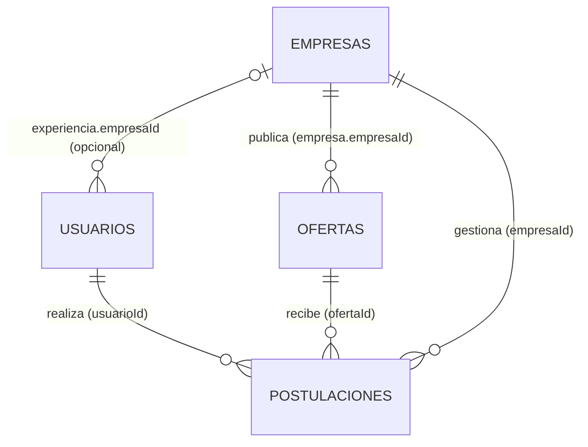

# Entrega parcial 1 — Propuesta y diseño de la base de datos

**Proyecto:** Plataforma de empleos estilo LinkedIn
**Asignatura:** Base de Datos Aplicada — UCC
**Integrantes:** Facundo Grillo, María Emilia Lasa, Gonzalo Marín
**Motor:** MongoDB 7 (replica set de un nodo en Docker, para habilitar transacciones)

---

## 1. Descripción del problema

Las personas que buscan trabajo publican un perfil profesional (experiencia, estudios, habilidades, idiomas) y las empresas publican ofertas laborales con requisitos, modalidad y rango salarial. La plataforma tiene que vincular ambas partes: los candidatos se postulan a ofertas y las empresas gestionan esas postulaciones hasta cubrir sus vacantes.

El dominio justifica una base documental porque:

- **Los perfiles son heterogéneos.** Un perfil junior puede no tener experiencia; uno senior puede tener diez puestos, certificaciones e idiomas. Muchos atributos son opcionales y varían en cantidad, lo que en un modelo relacional obligaría a varias tablas y a muchos JOIN para reconstruir un perfil.
- **El perfil se lee casi siempre completo.** El patrón de acceso dominante es "mostrar el perfil de una persona", que en MongoDB se resuelve con una única lectura.
- **El esquema evoluciona.** Agregar nuevos tipos de datos al perfil (por ejemplo, portfolio o voluntariado) no requiere migraciones.

### 1.1. Actores

| Actor | Descripción |
| :--- | :--- |
| **Candidato** | Persona que crea y mantiene su perfil, busca ofertas y se postula. |
| **Reclutador** | Representante de una empresa: publica ofertas, revisa postulantes y cambia el estado de las postulaciones. |
| **Administrador** | Gestiona usuarios y empresas, y consulta indicadores de la plataforma. |

### 1.2. Alcance

Incluido en esta etapa: perfiles, empresas, ofertas y postulaciones.
Fuera de alcance por ahora (posibles extensiones, ver sección 8): publicaciones, conexiones entre usuarios y mensajería.

---

## 2. Requerimientos funcionales

| ID | Requerimiento |
| :--- | :--- |
| RF01 | Crear, consultar, actualizar y eliminar perfiles de usuario (**entidad principal del CRUD**). |
| RF02 | Listar usuarios con filtros básicos: skill, seniority, ciudad y disponibilidad. |
| RF03 | Registrar y consultar empresas. |
| RF04 | Publicar ofertas laborales, y pausarlas o cerrarlas. |
| RF05 | Buscar ofertas por modalidad, seniority, ubicación, rango salarial y skills. |
| RF06 | Postularse a una oferta abierta, una sola vez por oferta. |
| RF07 | Cambiar el estado de una postulación y conservar el historial de cambios. |
| RF08 | Aceptar a un candidato descontando una vacante de la oferta y cerrarla cuando no queden vacantes. |
| RF09 | Obtener los candidatos que mejor coinciden con las skills requeridas de una oferta (*matching*). |
| RF10 | Generar indicadores: skills más demandadas frente a las más ofrecidas, salarios por seniority, tasa de aceptación, postulaciones por período. |

---

## 3. Entidades identificadas

| Entidad | Tratamiento en el modelo |
| :--- | :--- |
| Usuario / perfil | Colección `usuarios` |
| Experiencia laboral | Embebida en `usuarios` |
| Formación académica | Embebida en `usuarios` |
| Skills, idiomas, certificaciones | Arreglos embebidos en `usuarios` |
| Empresa | Colección `empresas` |
| Oferta laboral | Colección `ofertas` |
| Postulación | Colección `postulaciones` |
| Historial de estados de una postulación | Embebido en `postulaciones` |

---

## 4. Colecciones y estructura de documentos

Los ejemplos usan la notación de `mongosh` (`ObjectId(...)`, `ISODate(...)`).

**Convenciones generales:**

- Nombres de campos en español y en `camelCase`.
- Fechas como `Date` (ISODate), nunca como texto.
- Importes como enteros (`int`/`long`) en la unidad de la moneda indicada, para evitar errores de redondeo de los decimales en coma flotante.
- **Skills normalizadas:** en minúscula y con un nombre canónico (`"mongodb"`, `"python"`, `"react"`). Es indispensable para que el *matching* y las agregaciones comparen correctamente.
- Todos los documentos tienen `creadoEn` y `actualizadoEn`.

### 4.1. `usuarios` (entidad principal)

```js
{
  _id: ObjectId("6710a1f0c1a2b3c4d5e6f001"),
  nombre: "Lucía",
  apellido: "Fernández",
  email: "lucia.fernandez@example.com",          // único
  titular: "Backend Developer | Python · MongoDB",
  seniority: "semi-senior",                      // junior | semi-senior | senior | lead
  ubicacion: {
    ciudad: "Córdoba",
    provincia: "Córdoba",
    pais: "Argentina"
  },
  skills: ["python", "fastapi", "mongodb", "docker", "git"],
  experiencia: [
    {
      empresaId: ObjectId("6710a1f0c1a2b3c4d5e6f101"), // null si la empresa no está registrada
      empresaNombre: "Nubia Software",
      puesto: "Desarrolladora Backend",
      desde: ISODate("2023-03-01"),
      hasta: null,                                    // null = trabajo actual
      actual: true,
      descripcion: "APIs REST con FastAPI y MongoDB."
    },
    {
      empresaId: null,
      empresaNombre: "Freelance",
      puesto: "Desarrolladora Web",
      desde: ISODate("2021-06-01"),
      hasta: ISODate("2023-02-28"),
      actual: false
    }
  ],
  educacion: [
    {
      institucion: "Universidad Católica de Córdoba",
      titulo: "Ingeniería en Sistemas",
      desde: ISODate("2019-03-01"),
      hasta: null,
      estado: "en_curso"                        // en_curso | finalizado | abandonado
    }
  ],
  idiomas: [                                    // opcional
    { idioma: "inglés", nivel: "B2" }
  ],
  certificaciones: [                            // opcional
    { nombre: "MongoDB Associate Developer", emisor: "MongoDB", fecha: ISODate("2024-08-10") }
  ],
  preferencias: {                               // opcional
    disponible: true,
    modalidades: ["remoto", "hibrido"],
    salarioPretendido: { monto: 1800000, moneda: "ARS", periodo: "mensual" }
  },
  contacto: {                                   // opcional
    telefono: "+54 351 555-0101",
    github: "https://github.com/luciaf"
  },
  creadoEn: ISODate("2024-10-02T14:21:00Z"),
  actualizadoEn: ISODate("2026-09-15T09:10:00Z")
}
```

| Campo | Obligatorio | Tipo | Observaciones |
| :--- | :---: | :--- | :--- |
| `nombre`, `apellido` | Sí | string | |
| `email` | Sí | string | Único (índice único). |
| `seniority` | Sí | string (enum) | |
| `ubicacion` | Sí | documento anidado | `ciudad` y `pais` obligatorios; `provincia` opcional. |
| `skills` | Sí | arreglo de string | Puede estar vacío. |
| `experiencia` | Sí | arreglo de documentos | Puede estar vacío (perfil junior). |
| `educacion` | Sí | arreglo de documentos | Puede estar vacío. |
| `titular` | No | string | |
| `idiomas`, `certificaciones` | No | arreglo de documentos | |
| `preferencias`, `contacto` | No | documento anidado | |

### 4.2. `empresas`

```js
{
  _id: ObjectId("6710a1f0c1a2b3c4d5e6f101"),
  nombre: "Nubia Software",                     // único
  industria: "Tecnología",
  tamanio: "51-200",                            // 1-10 | 11-50 | 51-200 | 201-1000 | 1000+
  ubicacion: { ciudad: "Córdoba", provincia: "Córdoba", pais: "Argentina" },
  sitioWeb: "https://nubia.example.com",        // opcional
  descripcion: "Consultora de desarrollo de software a medida.", // opcional
  creadoEn: ISODate("2024-01-10T12:00:00Z"),
  actualizadoEn: ISODate("2024-01-10T12:00:00Z")
}
```

Obligatorios: `nombre`, `industria`, `tamanio`, `ubicacion`. Opcionales: `sitioWeb`, `descripcion`.

### 4.3. `ofertas`

```js
{
  _id: ObjectId("6710a1f0c1a2b3c4d5e6f201"),
  empresa: {                                    // referencia extendida
    empresaId: ObjectId("6710a1f0c1a2b3c4d5e6f101"),
    nombre: "Nubia Software"
  },
  titulo: "Backend Developer Python",
  descripcion: "Buscamos dev backend para un equipo de producto...",
  seniority: "semi-senior",
  modalidad: "hibrido",                         // remoto | hibrido | presencial
  ubicacion: { ciudad: "Córdoba", provincia: "Córdoba", pais: "Argentina" }, // opcional si es remoto
  skillsRequeridas: ["python", "fastapi", "mongodb"],
  skillsDeseables: ["docker", "aws"],           // opcional
  salario: {                                    // opcional: no todas las empresas lo publican
    min: 1500000,
    max: 2100000,
    moneda: "ARS",
    periodo: "mensual"
  },
  vacantes: { total: 2, disponibles: 2 },
  estado: "abierta",                            // abierta | pausada | cerrada
  cantidadPostulaciones: 14,                    // contador desnormalizado
  fechaPublicacion: ISODate("2026-09-01T10:00:00Z"),
  fechaCierre: null,
  creadoEn: ISODate("2026-09-01T10:00:00Z"),
  actualizadoEn: ISODate("2026-10-10T16:30:00Z")
}
```

Obligatorios: `empresa`, `titulo`, `descripcion`, `seniority`, `modalidad`, `skillsRequeridas`, `vacantes`, `estado` y `fechaPublicacion`. Opcionales: `ubicacion` (obligatoria si la modalidad no es remota), `skillsDeseables`, `salario` y `fechaCierre`.

Reglas de integridad: `0 <= vacantes.disponibles <= vacantes.total` y `salario.min <= salario.max`.

### 4.4. `postulaciones`

```js
{
  _id: ObjectId("6710a1f0c1a2b3c4d5e6f301"),
  usuarioId: ObjectId("6710a1f0c1a2b3c4d5e6f001"),
  ofertaId: ObjectId("6710a1f0c1a2b3c4d5e6f201"),
  empresaId: ObjectId("6710a1f0c1a2b3c4d5e6f101"),  // desnormalizado para consultas por empresa
  estado: "entrevista",       // enviada | en_revision | entrevista | aceptada | rechazada | retirada
  coincidenciaSkills: 0.67,   // proporción de skills requeridas que cumple, calculada al postularse
  cartaPresentacion: "Me interesa el puesto porque...",  // opcional
  pretensionSalarial: { monto: 1900000, moneda: "ARS" },  // opcional
  historialEstados: [
    { estado: "enviada",     fecha: ISODate("2026-09-03T11:00:00Z") },
    { estado: "en_revision", fecha: ISODate("2026-09-05T09:20:00Z") },
    { estado: "entrevista",  fecha: ISODate("2026-09-12T15:00:00Z"), nota: "Entrevista técnica el 18/09" }
  ],
  fechaPostulacion: ISODate("2026-09-03T11:00:00Z"),
  actualizadoEn: ISODate("2026-09-12T15:00:00Z")
}
```

Obligatorios: `usuarioId`, `ofertaId`, `empresaId`, `estado`, `historialEstados` (con al menos un elemento) y `fechaPostulacion`. Opcionales: `cartaPresentacion`, `pretensionSalarial` y `coincidenciaSkills`.

---

## 5. Relaciones entre documentos



| Relación | Cardinalidad | Implementación |
| :--- | :--- | :--- |
| Usuario → experiencia, educación, skills, idiomas | 1 a pocos | **Embebido** |
| Empresa → ofertas | 1 a muchos | **Referencia** en la oferta (`empresa.empresaId`), con el nombre desnormalizado |
| Usuario ↔ oferta (postulación) | muchos a muchos | **Colección propia** `postulaciones` con dos referencias |
| Postulación → historial de estados | 1 a pocos | **Embebido** |
| Experiencia → empresa | muchos a 1, opcional | **Referencia opcional** (`empresaId`) más `empresaNombre` |

---

## 6. Justificación de las decisiones de modelado

### 6.1. Experiencia, educación y skills embebidas en el usuario

- **Patrón de acceso:** al ver un perfil se muestra todo junto. Embebido, es una sola lectura y no hace falta ningún `$lookup`.
- **Cardinalidad acotada:** una persona tiene pocas decenas de experiencias o estudios como máximo. No hay riesgo de acercarse al límite de 16 MB por documento.
- **Ciclo de vida compartido:** una experiencia no existe sin su usuario. Al eliminar el usuario se eliminan sus datos embebidos, sin dejar documentos huérfanos.
- **Consultas igualmente posibles:** la notación de punto (`experiencia.empresaNombre`) y los índices multikey permiten buscar dentro de los arreglos sin sacarlos a otra colección.
- **Atomicidad:** actualizar el perfil completo (por ejemplo, agregar una experiencia y una skill) es una operación atómica sobre un solo documento.

### 6.2. Postulaciones como colección separada

Es la decisión más importante del modelo. Consideramos tres alternativas:

| Alternativa | Problema |
| :--- | :--- |
| Embeber las postulaciones en `ofertas` | Una oferta popular puede recibir cientos de postulaciones: el documento crece sin límite y cada cambio de estado reescribe un documento grande, con contención entre escrituras concurrentes. |
| Embeber las postulaciones en `usuarios` | El perfil se infla con datos que no se muestran en él, y listar los postulantes de una oferta obliga a recorrer todos los usuarios. |
| **Colección propia** ✅ | Crece sin afectar a los otros documentos, se consulta eficientemente desde ambos lados (índices por `usuarioId` y por `ofertaId`) y tiene su propio ciclo de vida (estados, historial). |

Además, un índice único sobre `{usuarioId, ofertaId}` garantiza en la base de datos que nadie se postule dos veces a la misma oferta (RF06).

### 6.3. Empresas referenciadas, con referencia extendida en las ofertas

- La empresa se comparte entre muchas ofertas y se modifica de forma independiente, por eso tiene su propia colección.
- En la oferta se guarda `empresa.nombre` además del ID (**patrón de referencia extendida**). El listado de ofertas, que es la consulta más frecuente, muestra el nombre sin `$lookup`.
- **Costo asumido:** si una empresa cambia de nombre, hay que hacer un `updateMany` sobre sus ofertas. Lo aceptamos porque es un cambio muy poco frecuente frente a la cantidad de lecturas.
- En `experiencia`, el `empresaId` es opcional porque una persona puede haber trabajado en empresas que no están registradas en la plataforma. Por eso también se guarda `empresaNombre`.

### 6.4. Desnormalizaciones controladas

| Campo | Motivo | Cómo se mantiene |
| :--- | :--- | :--- |
| `ofertas.empresa.nombre` | Listar ofertas sin `$lookup` | `updateMany` al renombrar la empresa |
| `postulaciones.empresaId` | Consultas y métricas por empresa sin pasar por `ofertas` | Se copia al crear la postulación (la empresa de una oferta no cambia) |
| `ofertas.cantidadPostulaciones` | Mostrar la popularidad sin un `count` por oferta | `$inc` al crear o retirar una postulación |
| `postulaciones.coincidenciaSkills` | Ordenar candidatos y analizar sin recalcular | Se calcula una vez al postularse (es una foto de ese momento) |

### 6.5. Por qué no guardamos arreglos de IDs sin límite

Evitamos campos como `ofertas.postulantes: [ObjectId, ...]` o `usuarios.postulaciones: [...]`. Son arreglos que crecen sin límite, duplican la información de `postulaciones` y obligarían a mantener dos lugares sincronizados.

---

## 7. Patrones de acceso previstos

| Operación | Frecuencia | Colección | Cómo se resuelve |
| :--- | :--- | :--- | :--- |
| Ver un perfil completo | Muy alta | `usuarios` | `findOne` por `_id`: una lectura |
| Buscar ofertas con filtros | Muy alta | `ofertas` | `find` por `estado`, `modalidad`, `seniority`, `salario` y `skillsRequeridas` |
| Listar postulantes de una oferta | Alta | `postulaciones` | `find({ofertaId})` ordenado por `coincidenciaSkills` |
| Listar mis postulaciones | Alta | `postulaciones` | `find({usuarioId})` ordenado por fecha |
| Buscar candidatos por skill | Media | `usuarios` | `find({skills: ...})` con índice multikey |
| Matching de candidatos para una oferta | Media | `usuarios` | `aggregate` con `$setIntersection` |
| Cambiar el estado de una postulación | Media | `postulaciones` | `updateOne` con `$set` y `$push` al historial (atómico) |
| Aceptar candidato | Baja | `postulaciones` + `ofertas` | **Transacción multidocumento** (ver 9) |
| Indicadores | Baja (analítica) | todas | Agregaciones y notebook |

---

## 8. Índices preliminares

Se detallarán y analizarán con `explain("executionStats")` en la Entrega 2.

| Colección | Índice | Motivo |
| :--- | :--- | :--- |
| `usuarios` | `{ email: 1 }` único | Unicidad del email |
| `usuarios` | `{ skills: 1 }` (multikey) | Búsqueda de candidatos por skill y *matching* |
| `ofertas` | `{ estado: 1, modalidad: 1, seniority: 1, "salario.min": 1 }` | Búsqueda principal de ofertas (igualdad, luego rango) |
| `ofertas` | `{ skillsRequeridas: 1 }` (multikey) | Ofertas que piden una skill dada |
| `postulaciones` | `{ usuarioId: 1, ofertaId: 1 }` único | Evitar postulaciones duplicadas; también sirve para listar por usuario |
| `postulaciones` | `{ ofertaId: 1, estado: 1 }` | Postulantes de una oferta, filtrados por estado |
| `empresas` | `{ nombre: 1 }` único | Unicidad y búsqueda por nombre |

Extensión opcional: un índice de texto sobre `ofertas.titulo` y `ofertas.descripcion`.

---

## 9. Casos de consistencia identificados

### 9.1. Aceptar a un candidato (transacción multidocumento)

La operación requiere:

1. Pasar la postulación a `aceptada` y agregar la entrada al historial.
2. Descontar una vacante: `ofertas.vacantes.disponibles - 1`.
3. Si `disponibles` llega a 0, poner la oferta en `cerrada` y registrar la `fechaCierre`.

**Qué puede fallar sin protección:**

- Si se completa (1) y falla (2), queda una contratación registrada sin descontar la vacante, y la oferta sigue aceptando candidatos de más.
- Si dos reclutadores aceptan al mismo tiempo con una sola vacante disponible, ambos podrían aceptar.

**Solución propuesta:** como la operación modifica documentos de dos colecciones, se resuelve con una **transacción multidocumento**:

- Dentro de la transacción, el descuento de la vacante es condicional: `updateOne({_id, estado: "abierta", "vacantes.disponibles": {$gt: 0}}, {$inc: {"vacantes.disponibles": -1}})`.
- Si no se modifica ningún documento, se aborta la transacción y la postulación no cambia.

Para esto, MongoDB corre como **replica set de un nodo** en Docker Compose, porque una instancia independiente no admite transacciones.

### 9.2. Cambio de estado de una postulación (operación atómica)

Actualizar `estado` y agregar la entrada al `historialEstados` afecta un solo documento. Se resuelve con un único `updateOne` con `$set` y `$push`, que es atómico, sin necesidad de transacción. Además, el filtro incluye el estado actual esperado para impedir transiciones inválidas (por ejemplo, reabrir una postulación `rechazada`).

### 9.3. Postularse (índice único + contador)

El índice único `{usuarioId, ofertaId}` impide postulaciones duplicadas aunque lleguen dos pedidos simultáneos. El `$inc` de `cantidadPostulaciones` es un contador informativo: si quedara desfasado, se puede recalcular con una agregación. Por eso evaluaremos en la Entrega 3 si justifica incluirlo en una transacción.

---

## 10. Plan de datos de prueba

Los datos se generarán con un script reproducible en Python con Faker, usando semilla fija y nombres de skills normalizados.

| Colección | Cantidad aproximada |
| :--- | ---: |
| `empresas` | 20 |
| `usuarios` | 120 |
| `ofertas` | 60 |
| `postulaciones` | 250 |
| **Total** | **~450** |

**Casos límite que se incluirán:**

- Usuarios sin experiencia laboral, sin idiomas ni preferencias.
- Usuarios con varias experiencias "actuales" a la vez.
- Experiencia en empresas no registradas (`empresaId: null`).
- Ofertas sin salario publicado y ofertas remotas sin ubicación.
- Ofertas cerradas con `vacantes.disponibles = 0` y ofertas pausadas.
- Postulaciones en todos los estados, incluidas `retirada` y `rechazada`.
- Una oferta sin postulaciones y otra con muchas.

---

## 11. Validación de esquema (extensión prevista)

Se definirán reglas `$jsonSchema` en cada colección (`createCollection` con `validator`) para los campos obligatorios, los enumerados (`seniority`, `modalidad`, `estado`) y los tipos. Las reglas entre campos (`min <= max`, `disponibles <= total`) se validarán en la capa de servicios de la API.

---

## 12. Posibles colecciones futuras

Si el tiempo lo permite, una vez cubiertos los requisitos obligatorios:

- **`publicaciones`:** posts de usuarios con reacciones. Los comentarios irían embebidos con un tope (patrón *subset*) o en una colección aparte.
- **`conexiones`:** relación entre usuarios en su propia colección (`{usuarioA, usuarioB, estado}`), nunca como arreglo dentro del usuario, porque crece sin límite.
