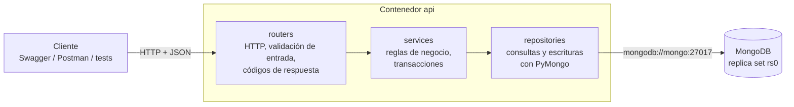

# Entrega parcial 3 — API, repositorios y consistencia

**Proyecto:** Plataforma de empleos estilo LinkedIn
**Integrantes:** Facundo Grillo, María Emilia Lasa, Gonzalo Marín
**Tecnologías:** Python 3.12, FastAPI, PyMongo, MongoDB 8.0 (replica set), Docker Compose

Esta entrega implementa:

- Una **API REST** con el CRUD completo de `usuarios`, la entidad principal.
- Una **capa de repositorios** que concentra todo el acceso a MongoDB.
- Las **operaciones de postulación**, incluido el caso de consistencia del proyecto: **aceptar a un candidato**, resuelto con una transacción multidocumento.
- **43 tests de integración** contra MongoDB real, incluidas pruebas de fallas simuladas y de concurrencia.

Las salidas reales de los tests y de la demostración están en [`docs/evidencia/`](evidencia/).

---

## 1. Cómo ejecutarla

```bash
bin/reset_db.sh                          # base creada y con datos (si no se hizo antes)
docker compose up -d --build --wait api  # levanta la API en http://localhost:8000
```

| Qué | Dónde / comando |
| :--- | :--- |
| Documentación interactiva (Swagger) | <http://localhost:8000/docs> |
| Tests de integración | `docker compose run --rm api pytest` |
| Demostración de todos los endpoints | `docker compose exec api python scripts/demo.py` |
| Volver la base al estado original después de probar | `bin/reset_db.sh` |

La API corre como servicio del mismo Docker Compose que MongoDB. Se conecta con `mongodb://…@mongo:27017/?replicaSet=rs0`, usando **el nombre del servicio (`mongo`) y no `localhost`**: dentro del contenedor de la API, `localhost` es el propio contenedor.

---

## 2. Arquitectura



```
api/
├── Dockerfile
├── requirements.txt
├── app/
│   ├── main.py            # crea la app, registra routers y traduce errores a HTTP
│   ├── database.py        # conexión y función en_transaccion()
│   ├── errores.py         # NoEncontrado (404), Conflicto (409), DatosInvalidos (422)
│   ├── schemas/           # modelos Pydantic de entrada y salida
│   ├── routers/           # capa HTTP
│   ├── services/          # capa de negocio
│   └── repositories/      # capa de acceso a datos
├── tests/                 # tests de integración (pytest)
└── scripts/demo.py        # recorrido de demostración
```

**Responsabilidad de cada capa:**

| Capa | Hace | No hace |
| :--- | :--- | :--- |
| **routers** | Define rutas y parámetros, valida el cuerpo con Pydantic y elige el código HTTP de éxito | No tiene lógica de negocio ni toca la base |
| **services** | Aplica reglas de negocio (transiciones de estado, quién se puede borrar, campos derivados), decide qué va en una transacción y lanza errores de dominio | No conoce HTTP ni usa PyMongo sobre las colecciones |
| **repositories** | Arma filtros y actualizaciones de MongoDB y ejecuta las operaciones. Cada escritura acepta una `sesion` para participar de una transacción | No decide reglas de negocio |

Gracias a esta separación, los servicios se pueden usar sin HTTP. Los tests de concurrencia y de fallas simuladas llaman directamente a `PostulacionesServicio`.

---

## 3. Endpoints

| Método | Ruta | Función | Respuestas |
| :--- | :--- | :--- | :--- |
| **POST** | `/usuarios` | Crear un usuario | 201, 409 (email repetido), 422 |
| **GET** | `/usuarios/{id}` | Obtener un usuario | 200, 404, 422 (id mal formado) |
| **PATCH** | `/usuarios/{id}` | Actualizar parcialmente | 200, 404, 409, 422 |
| **DELETE** | `/usuarios/{id}` | Eliminar un usuario y sus postulaciones | 204, 404, 409 (tiene contrataciones) |
| **GET** | `/usuarios` | Listar con filtros `skill` (repetible), `seniority`, `provincia`, `ciudad`, `disponible`, y paginación `limite` y `desplazamiento` | 200 |
| GET | `/usuarios/{id}/postulaciones` | Postulaciones de un usuario | 200, 404 |
| GET | `/ofertas` | Buscar ofertas por `estado`, `seniority`, `modalidad`, `skill`, `moneda`, `salarioMinimo` | 200, 422 |
| GET | `/ofertas/{id}` | Obtener una oferta | 200, 404 |
| GET | `/ofertas/{id}/postulaciones` | Postulantes de una oferta, ordenados por mayor coincidencia | 200, 404 |
| POST | `/ofertas/{id}/postulaciones` | Postularse a una oferta | 201, 404, 409 |
| GET | `/postulaciones/{id}` | Obtener una postulación | 200, 404 |
| PATCH | `/postulaciones/{id}/estado` | Cambiar el estado (incluye **aceptar candidato**) | 200, 404, 409 |
| GET | `/empresas`, `/empresas/{id}` | Consultar empresas | 200, 404 |
| GET | `/salud` | Verificar la conexión con MongoDB | 200, 503 |

En negrita, el CRUD de la entidad principal que pide la consigna. Las rutas de postulaciones dan soporte al caso de consistencia.

**Formato de error** (igual en todos los endpoints):

```json
{ "error": "conflicto", "detalle": "Ya existe un usuario con el email lucia.fernandez@demo.example" }
```

Los errores de validación agregan el campo que falló:

```json
{
  "error": "datos_invalidos",
  "detalle": "La petición tiene datos inválidos",
  "errores": [
    { "campo": "body.email", "mensaje": "String should match pattern '^[^@\\s]+@[^@\\s]+\\.[^@\\s]+$'" },
    { "campo": "body.seniority", "mensaje": "Input should be 'junior', 'semi-senior', 'senior' or 'lead'" }
  ]
}
```

| Código | Cuándo |
| :--- | :--- |
| 200 / 201 / 204 | Éxito (consulta o actualización / creación / eliminación) |
| 404 `no_encontrado` | El id tiene formato válido pero no existe |
| 409 `conflicto` | La operación es válida pero choca con el estado de los datos: email repetido, postulación duplicada, transición no permitida, oferta sin vacantes, usuario con contrataciones |
| 422 `datos_invalidos` | El cuerpo o los parámetros no cumplen el esquema, el id está mal formado o se referencia una empresa inexistente |
| 503 `base_no_disponible` | MongoDB no responde |

---

## 4. Validación de datos

Validamos en tres niveles. Cada uno atrapa lo que el anterior no puede ver:

| Nivel | Dónde | Qué valida |
| :--- | :--- | :--- |
| 1. Esquema de entrada | Pydantic ([`schemas/`](../api/app/schemas/)) | Tipos, obligatorios, valores permitidos, formato de email, longitudes, **campos desconocidos** (`extra="forbid"`) y coherencia interna (`hasta >= desde`; `actual` coherente con `hasta`; experiencia con empresa) |
| 2. Reglas que requieren consultar la base | Servicios | La empresa referenciada en la experiencia existe; la transición de estado es válida desde el estado actual; la oferta está abierta; el usuario no tiene contrataciones antes de borrarlo |
| 3. Red de seguridad | MongoDB: validador `$jsonSchema` (Entrega 2) e índices únicos | Si un error de programación dejara pasar un documento inválido, la base lo rechaza (la API responde 422). La unicidad del email y de cada postulación la garantizan los índices únicos, incluso con peticiones simultáneas |

**Normalización y campos derivados** (los decide la API, no el cliente):

- **`email`:** se guarda en minúscula, así `Ana@X.com` y `ana@x.com` son el mismo usuario.
- **`skills`:** se guardan en minúscula, sin espacios y sin repetidos. Es necesario para que coincidan con las de las ofertas en el *matching*.
- **`experiencia[].actual`:** se calcula como `hasta == null`. Si el cliente lo envía y no coincide, es un error 422.
- **`experiencia[].empresaNombre`:** cuando se indica `empresaId`, se copia de la colección `empresas` e ignora lo que mande el cliente. Es la desnormalización controlada que planteamos en la Entrega 1.
- **`coincidenciaSkills`:** se calcula al postularse.
- **`creadoEn` y `actualizadoEn`:** las pone siempre el servidor.

**Semántica de `PATCH /usuarios/{id}`:**

- Solo cambian los campos enviados.
- Un campo opcional enviado como `null` se elimina del documento (`$unset`).
- Un campo obligatorio enviado como `null` es un error 422.
- Los arreglos se reemplazan completos.
- Un cuerpo vacío es un error 422.

**Listados:** devuelven una versión resumida del usuario, sin experiencia, educación ni contacto, y siempre paginada (`limite` entre 1 y 100). El perfil completo se lee de a uno, que es el patrón de acceso previsto en el diseño.

---

## 5. Consistencia: aceptar a un candidato

### 5.1. La operación

Cuando un reclutador acepta a un candidato (`PATCH /postulaciones/{id}/estado` con `{"estado": "aceptada"}`), hay que hacer tres escrituras en dos colecciones:

1. **`postulaciones`:** el estado pasa a `aceptada` y se agrega la entrada al historial.
2. **`ofertas`:** `vacantes.disponibles` baja en 1.
3. **`ofertas`:** si era la última vacante, la oferta pasa a `cerrada` con su `fechaCierre`.

### 5.2. Qué puede salir mal sin protección

| Escenario | Resultado inconsistente |
| :--- | :--- |
| Se completa (1) y falla (2) | Una contratación registrada que no descontó vacante: la oferta sigue recibiendo y aceptando candidatos de más |
| Se completa (2) y falla (3) | Oferta "abierta" con 0 vacantes disponibles |
| Dos reclutadores aceptan al mismo tiempo la última vacante | Dos contrataciones para una vacante. Con "leer y después escribir", la segunda escritura pisa a la primera (lo demostramos en la prueba 2a de la Entrega 2) |
| La postulación estaba en un estado que no permite aceptar (por ejemplo, `rechazada`) | Una contratación que no debería existir |

### 5.3. Solución

Como la operación modifica **documentos de dos colecciones distintas**, no alcanza con una operación atómica sobre un documento. Por eso usamos una **transacción multidocumento**. Dentro de ella, cada paso es además una operación **condicional**:

```python
# app/services/postulaciones.py (simplificado)
def operacion(sesion):
    # 1. Sólo cambia si el estado actual permite pasar a "aceptada" (sólo desde "entrevista")
    postulacion = postulaciones.cambiar_estado(id, desde=["entrevista"], hacia="aceptada", sesion=sesion)
    if postulacion is None:
        explicar_rechazo(id)                     # 404 o 409 -> la transacción se aborta

    # 2. Descuenta sólo si la oferta está abierta y le queda al menos una vacante
    oferta = ofertas.descontar_vacante(postulacion["ofertaId"], sesion=sesion)
    if oferta is None:
        raise Conflicto("La oferta no está abierta o ya no tiene vacantes disponibles")  # aborta: deshace el paso 1

    # 3. Si era la última, se cierra
    if oferta["vacantes"]["disponibles"] == 0:
        ofertas.cerrar(oferta["_id"], sesion=sesion)

en_transaccion(db, operacion)   # with_transaction: readConcern "snapshot", writeConcern "majority"
```

```python
# app/repositories/ofertas.py
def descontar_vacante(self, id, fecha, sesion=None):
    return self.coleccion.find_one_and_update(
        {"_id": id, "estado": "abierta", "vacantes.disponibles": {"$gt": 0}},
        {"$inc": {"vacantes.disponibles": -1}, "$set": {"actualizadoEn": fecha}},
        return_document=ReturnDocument.AFTER, session=sesion)
```

**Cómo cubre cada escenario:**

- **Falla a mitad de camino:** cualquier excepción dentro de `operacion`, ya sea un `Conflicto` nuestro o un error inesperado, aborta la transacción, y MongoDB descarta todas sus escrituras.
- **Concurrencia:** las dos transacciones modifican el mismo documento de la oferta. MongoDB detecta el **conflicto de escritura** y aborta una de ellas con un error transitorio. `with_transaction` la **reintenta automáticamente**. En el reintento, la lectura ya ve la vacante descontada por la otra, el paso 2 no encuentra vacantes y la aceptación se rechaza con 409.
- **Estado inválido:** el filtro `estado ∈ ["entrevista"]` del paso 1 impide la transición, aunque otra petición haya cambiado el estado un instante antes.
- **Garantía final:** el validador `$jsonSchema` (`vacantes.disponibles >= 0` y `<= total`) actúa como última barrera.

**Costo de esta decisión:**

- Las transacciones necesitan un replica set. Por eso MongoDB corre como replica set de un nodo desde la Entrega 2.
- Agregan latencia y pueden reintentarse, así que el código dentro de la transacción no debe tener efectos fuera de la base (por ejemplo, enviar un mail).
- Las usamos solo donde hacen falta: ver 5.4.

**Alternativa descartada:** guardar las postulaciones aceptadas dentro de la oferta haría que todo fuera una operación atómica sobre un solo documento. Pero contradice la decisión de la Entrega 1 de tener `postulaciones` como colección propia: crecen sin límite y se consultan desde el usuario y desde la oferta. No vale la pena empeorar el modelo para ahorrar una transacción en una operación poco frecuente.

### 5.4. Qué mecanismo usa cada operación

| Operación | Documentos que modifica | Mecanismo |
| :--- | :--- | :--- |
| Pasar a `en_revision`, `entrevista` o `rechazada` | 1 postulación | Operación atómica: `find_one_and_update` con `$set` + `$push` y filtro por estado de origen |
| **Aceptar** | 1 postulación + 1 oferta | **Transacción** + `$inc` condicional |
| Retirar | 1 postulación + 1 oferta (contador) | Transacción |
| Postularse | 1 postulación nueva + 1 oferta (contador) | Transacción + índice único `{usuarioId, ofertaId}` contra duplicados |
| Eliminar usuario | 1 usuario + sus postulaciones + N ofertas (contadores) | Transacción; rechazada (409) si tiene contrataciones |
| Crear o actualizar usuario | 1 usuario | Operación sobre un documento; índice único de email |

### 5.5. Pruebas del comportamiento ante errores

Están en [`api/tests/test_postulaciones.py`](../api/tests/test_postulaciones.py). Todas terminan llamando a `verificar_consistencia()`, que controla para cada oferta que `disponibles = total − aceptadas`, que `cantidadPostulaciones = postulaciones no retiradas` y que una oferta sin vacantes esté cerrada.

| Test | Escenario | Resultado verificado |
| :--- | :--- | :--- |
| `test_aceptar_descuenta_una_vacante_y_la_oferta_sigue_abierta` | Oferta con 2 vacantes | La postulación queda aceptada, la oferta con 1 disponible y abierta |
| `test_aceptar_la_ultima_vacante_cierra_la_oferta` | Oferta con 1 vacante | Disponibles 0, oferta cerrada y con `fechaCierre` |
| `test_aceptar_sin_vacantes_devuelve_409_y_deshace_el_cambio_de_la_postulacion` | El paso 1 se ejecuta, el paso 2 no encuentra vacantes | 409, y la postulación queda **idéntica** a antes: ni el estado ni el historial cambiaron |
| `test_falla_a_mitad_de_la_transaccion_no_deja_cambios_parciales` | Se reemplaza `cerrar()` por una función que lanza una excepción, **después** de que la postulación ya se aceptó y la vacante ya se descontó | La excepción se propaga y la postulación y la oferta quedan **idénticas** a antes |
| `test_aceptaciones_simultaneas_no_superan_las_vacantes` | 5 hilos aceptan a la vez a 5 candidatos distintos para 1 vacante (sincronizados con una barrera para que arranquen juntos) | Exactamente 1 aceptación y 4 rechazos por falta de vacantes; la oferta queda cerrada con 0 disponibles |
| `test_transicion_no_permitida_devuelve_409_sin_modificar` (4 casos) | enviada → aceptada, rechazada → entrevista, retirada → en_revision, aceptada → rechazada | 409 y el documento sin cambios |
| `test_eliminar_usuario_con_contratacion_devuelve_409_y_no_borra_nada` | Borrar a un usuario contratado | 409; el usuario y sus postulaciones siguen ahí |

Para descartar que los tests de consistencia pasaran por casualidad, los ejecutamos 10 veces seguidas. Pasaron en las 10 corridas.

También lo probamos sobre los **datos reales del proyecto** con la demo ([`evidencia/07_demo_api.txt`](evidencia/07_demo_api.txt), pasos 12 a 14). Un candidato nuevo se postula, avanza y es aceptado, y la oferta, que tenía 1 vacante, queda cerrada. Después otro postulante de la misma oferta llega a entrevista e intenta ser aceptado: recibe 409, y su postulación sigue en `entrevista`. Al terminar la demo, `03_verificacion.js` vuelve a dar **todos los controles OK** ([`evidencia/09_verificacion_despues_de_demo.txt`](evidencia/09_verificacion_despues_de_demo.txt)), es decir, las escrituras de la API mantuvieron todas las reglas de consistencia de la base.

---

## 6. Tests

```bash
docker compose run --rm api pytest
```

```
============================== 43 passed in 0.46s ==============================
```

Salida completa en [`evidencia/08_tests_api.txt`](evidencia/08_tests_api.txt).

**Cómo están armados:**

- Son **de integración**: hacen peticiones HTTP reales a la API (con `TestClient` de FastAPI) y usan un MongoDB real. No hay *mocks* de la base, salvo la falla simulada.
- Corren sobre una base aparte, **`empleos_test`**, que se crea al empezar copiando de `empleos` las colecciones con sus **validadores e índices**. Así los tests verifican también las reglas de la base, sin tocar los datos del proyecto. Al terminar, la base de pruebas se borra.
- Cada test empieza con las colecciones vacías y arma su propio escenario con la clase `Fabrica` de [`conftest.py`](../api/tests/conftest.py).

| Archivo | Tests | Qué cubre |
| :--- | ---: | :--- |
| [`test_usuarios.py`](../api/tests/test_usuarios.py) | 25 | CRUD completo: creación con normalización y campos derivados; 9 variantes de datos inválidos; email duplicado; empresa inexistente; 404 y id mal formado; filtros y paginación; PATCH parcial, `null`, cuerpo vacío y email de otro usuario; eliminación con y sin contrataciones |
| [`test_postulaciones.py`](../api/tests/test_postulaciones.py) | 18 | Postularse (coincidencia, contador, duplicado, oferta cerrada o pausada, 404); transiciones válidas e inválidas; retirar; aceptar en todos sus escenarios, incluidos falla simulada y concurrencia; listado de postulantes |

---

## 7. Decisiones y cambios respecto de entregas anteriores

- **Eliminar un usuario con contrataciones se rechaza (409).** Borrar su postulación aceptada dejaría `vacantes.disponibles` inconsistente con las aceptadas, y además se perdería un dato histórico. Los usuarios sin contrataciones sí se pueden borrar, junto con sus postulaciones, en una transacción.
- **"Aceptar" es un estado más** dentro de `PATCH /postulaciones/{id}/estado`, y no un endpoint aparte. El cliente ve una única operación de cambio de estado, y el servicio decide internamente que esa transición en particular requiere una transacción.
- **Al cerrarse una oferta, sus postulaciones activas no se rechazan automáticamente.** El reclutador las rechaza explícitamente. Hacerlo automático agregaría más escrituras a la transacción de aceptar.
- **El contador `cantidadPostulaciones`**, que en la Entrega 2 dejamos como "a evaluar", ahora se mantiene **dentro de transacciones** (postularse, retirar, eliminar usuario). La verificación posterior a la demo confirma que no se desincroniza.

## 8. Pendiente para la Entrega 4

- Notebook de análisis de datos, partiendo de las consultas 7, 8, 9 y 11 de la Entrega 2.
- Prueba completa desde un entorno limpio (clonar → `.env` → `reset_db.sh` → API → tests).
- Informe final y preparación de la defensa.
