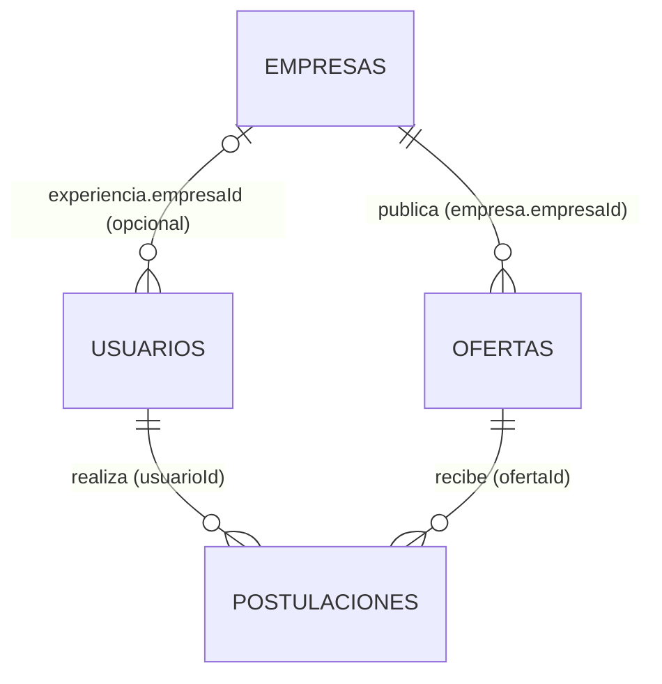
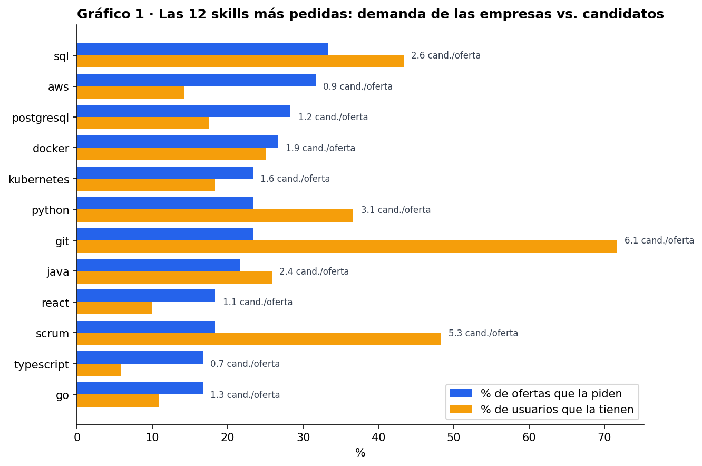
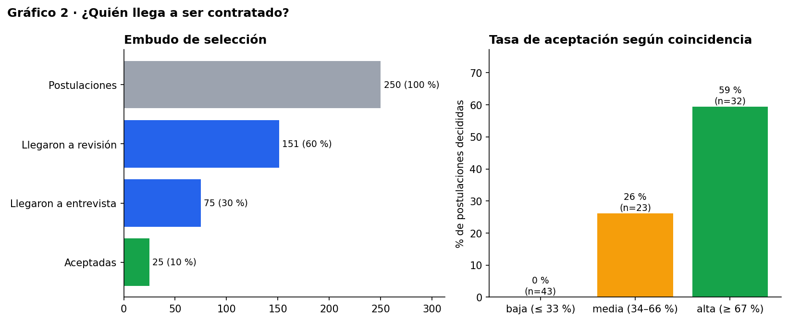
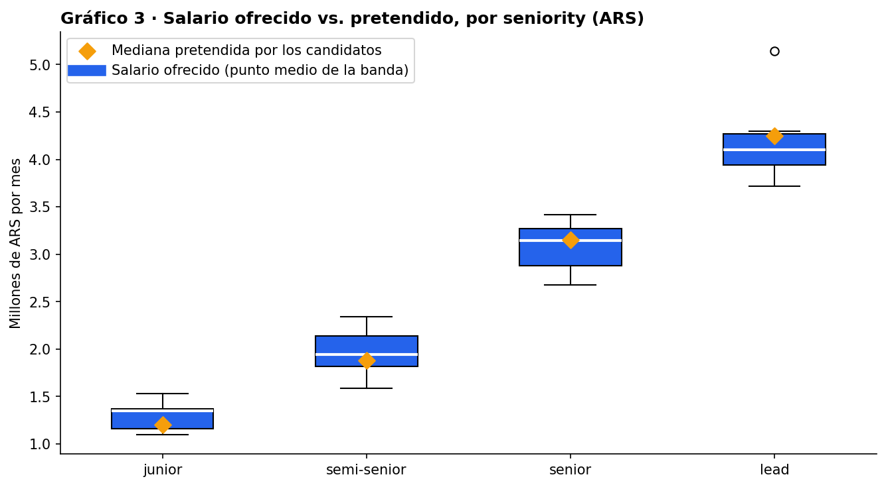
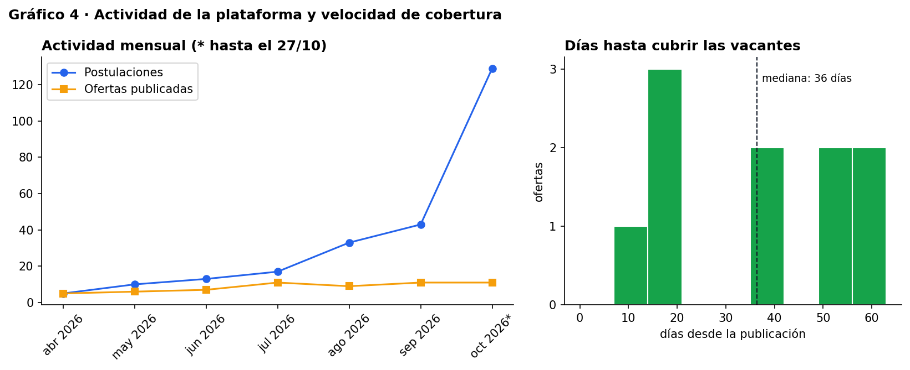

# Informe técnico final — Plataforma de empleos estilo LinkedIn

**Trabajo práctico integrador · Base de Datos Aplicada · UCC**
**Integrantes:** Facundo Grillo, María Emilia Lasa, Gonzalo Marín
**Repositorio:** <https://github.com/facundogrilloucc/Proyecto-MongoDB-UCC>

Este informe reúne el trabajo completo. El detalle de cada etapa está en los documentos de las entregas parciales:

- [Entrega 1 — Diseño](entrega-1-diseno.md)
- [Entrega 2 — Implementación, consultas e índices](entrega-2.md)
- [Entrega 3 — API y consistencia](entrega-3.md)
- [Notebook de análisis](../analisis/analisis.ipynb)

---

## 1. Resumen

Construimos la base de datos de una plataforma de empleos donde los candidatos publican su perfil profesional, las empresas publican ofertas y los candidatos se postulan. La solución incluye:

| Componente | Implementación |
| :--- | :--- |
| Base documental | MongoDB 8.0 como replica set de un nodo; 4 colecciones con validación `$jsonSchema` |
| Datos | 450 documentos sintéticos, reproducibles con semilla fija, con casos límite |
| Consultas | 13 consultas: filtros, operadores lógicos, anidados, arreglos, 5 agregaciones, *matching* y búsqueda de texto |
| Índices | 8 índices (únicos, compuestos, multikey y de texto) analizados con `explain("executionStats")` |
| API | FastAPI con capas `routers` → `services` → `repositories`; CRUD de usuarios y gestión de postulaciones |
| Consistencia | Transacción multidocumento para aceptar candidatos, probada ante fallas y concurrencia |
| Pruebas | 43 tests de integración contra MongoDB real |
| Análisis | Notebook con PyMongo, Pandas y Matplotlib: 9 indicadores, 4 gráficos, conclusiones y recomendación |
| Entorno | Docker Compose con 4 servicios: `mongo`, `api`, `seed` y `analisis`. Probado desde cero |

---

## 2. Problema y requerimientos

Las personas que buscan trabajo tienen perfiles muy distintos entre sí: un junior puede no tener experiencia y un senior puede tener diez trabajos, certificaciones e idiomas. Las empresas publican ofertas con requisitos, modalidad y rango salarial, y gestionan las postulaciones hasta cubrir sus vacantes.

**Actores:**

- **Candidato:** gestiona su perfil y se postula.
- **Reclutador:** publica ofertas y avanza o rechaza postulaciones.
- **Administrador:** consulta los indicadores.

**Requerimientos principales:**

- CRUD de perfiles (entidad principal).
- Búsqueda de candidatos y de ofertas.
- Postularse una sola vez por oferta.
- Ciclo de estados de la postulación con historial.
- Aceptar candidatos sin superar las vacantes.
- *Matching* de candidatos.
- Indicadores del mercado.

La lista completa está en la Entrega 1, sección 2.

**Por qué una base documental:**

- Los perfiles son **heterogéneos**: muchos campos son opcionales y su cantidad varía.
- El perfil se **lee casi siempre completo**, y en MongoDB eso es una sola lectura, sin *joins*.
- El esquema puede **evolucionar** sin migraciones.

---

## 3. Modelo documental

| Colección | Documentos | Contenido | Embebido |
| :--- | ---: | :--- | :--- |
| `usuarios` | 120 | Perfil profesional (**entidad principal**) | experiencia, educación, skills, idiomas, certificaciones, preferencias |
| `empresas` | 20 | Datos de la empresa | — |
| `ofertas` | 60 | Puesto, skills, salario, vacantes, estado | referencia extendida a la empresa `{empresaId, nombre}` |
| `postulaciones` | 250 | Relación usuario ↔ oferta | historial de estados |

### Decisiones principales

| Decisión | Motivo | Costo asumido |
| :--- | :--- | :--- |
| **Experiencia, educación y skills embebidas** en el usuario | Relación 1 a pocos, acotada (`maxItems` en el validador), se lee junto con el perfil y comparte su ciclo de vida | Buscar "quién trabajó en X" recorre arreglos; se resuelve con notación de punto e índices multikey |
| **Postulaciones en colección propia** | Muchos a muchos que crece sin límite, se consulta desde los dos lados y tiene su propio ciclo de vida | Aceptar un candidato toca dos colecciones, por eso necesita una transacción (sección 6) |
| **Historial de estados embebido** en la postulación | Pocos elementos, siempre se lee con la postulación; el cambio de estado y el historial se actualizan en una sola operación atómica | — |
| **Referencia extendida** a la empresa en la oferta | El listado de ofertas, la consulta más frecuente, muestra el nombre sin `$lookup` | Renombrar una empresa exige un `updateMany` sobre sus ofertas |
| **Desnormalizaciones controladas**: `cantidadPostulaciones`, `postulaciones.empresaId`, `coincidenciaSkills` | Evitar recalcular en cada lectura | Mantenerlas sincronizadas: la API lo hace dentro de transacciones y `03_verificacion.js` lo controla |
| **Sin arreglos de IDs que crecen sin límite** (por ejemplo, postulantes dentro de la oferta) | Evitar documentos que crecen indefinidamente y la información duplicada | — |

### Validación en la base

Cada colección tiene un validador que combina:

- **`$jsonSchema`:** campos obligatorios, tipos, valores permitidos, formato de email, skills sin repetir y tamaño máximo de los arreglos.
- **Condiciones entre campos:** `vacantes.disponibles <= total`, `salario.min <= salario.max` y ubicación obligatoria si la oferta no es remota.

Siete inserciones inválidas de prueba son rechazadas con el código 121.

---

## 4. Implementación y datos

- **Scripts reproducibles:** [`bin/reset_db.sh`](../bin/reset_db.sh) borra la base, crea las colecciones con sus validadores, carga los datos, crea los índices y verifica todo. Se puede ejecutar todas las veces que haga falta.
- **Generador** ([`seed/generar_datos.py`](../seed/generar_datos.py)): Python + Faker, con semilla y fecha de referencia fijas.
  - Genera exactamente los mismos documentos en cada ejecución, incluidos los `_id`.
  - Los datos son coherentes entre colecciones: las vacantes disponibles coinciden con las postulaciones aceptadas y las fechas respetan la cronología.
- **Casos límite:**
  - Usuarios sin experiencia o sin skills, y usuarios fuera de Argentina.
  - Trabajos simultáneos y experiencias en empresas no registradas.
  - Ofertas sin salario y ofertas remotas sin ubicación.
  - Ofertas cerradas, pausadas y sin postulaciones.
  - Postulaciones en todos los estados.
- **Verificación:** [`03_verificacion.js`](../db/scripts/03_verificacion.js) controla:
  - La integridad referencial, mediante `$lookup` que busca documentos huérfanos.
  - Seis reglas de negocio.
  - Las validaciones.

---

## 5. Consultas e índices

### 5.1. Consultas

| # | Pregunta del dominio | Técnica |
| :--- | :--- | :--- |
| 1 | Ofertas abiertas semi-senior que pagan al menos $1,7 M | Comparación (`$gte`) y orden |
| 2 | Postulaciones activas recientes con coincidencia ≥ 75 % | Comparación (`$gte`, `$nin`) sobre números y fechas |
| 3 | Ofertas a las que puede aplicar alguien de Córdoba | Lógicos (`$or`, `$ne`, `$in`) |
| 4 | Candidatos de Córdoba disponibles para remoto con pretensión ≤ $2 M | Atributos anidados de 3 niveles |
| 5 | Quién sabe Python y SQL y trabaja hoy en una empresa registrada | Arreglos: `$all` + `$elemMatch` (en filtro y proyección) |
| 6 | Las 10 ofertas mejor pagas | Proyección con campos calculados, orden y límite |
| 7 | Embudo y tasa de aceptación por empresa | `aggregate`: `$group` condicional + `$lookup` |
| 8 | Skills más demandadas que ofrecidas | `aggregate`: `$unwind` + `$unionWith` + `$facet` |
| 9 | Salario por seniority y moneda | Estadísticas: `$avg`, `$min`, `$max`, `$stdDevPop` |
| 10 | **Matching**: mejores candidatos que aún no se postularon | `$setIntersection` + `$lookup` con pipeline + ranking |
| 11 | Evolución mensual de las postulaciones | `$dateTrunc` |
| 12 | Coherencia entre años de experiencia y seniority | `$map` + `$dateDiff` sobre el arreglo embebido |
| 13 | Búsqueda libre de ofertas | Índice de texto en español con `textScore` |

### 5.2. Índices

| Índice | Uso | Resultado de `explain` (docs examinados con índice / sin índice) |
| :--- | :--- | :--- |
| `ofertas {estado, seniority, salario.moneda, salario.min}` | Búsqueda principal (regla ESR) | 3 / 60, y sin etapa `SORT` en memoria |
| `usuarios {skills}` multikey | Candidatos por skill, *matching* | 44 / 120 |
| `postulaciones {ofertaId, estado}` | Postulantes de una oferta | 21 / 250 |
| `postulaciones {usuarioId, ofertaId}` único | Evita duplicados; su prefijo resuelve "mis postulaciones" | 6 / 250 |
| `usuarios {email}` único | Unicidad y búsqueda por email | 1 / 120 (`EXPRESS_IXSCAN`) |
| `empresas {nombre}` único, `ofertas {skillsRequeridas}`, `ofertas` de texto | Unicidad, filtros y búsqueda libre | — |

Con 450 documentos los tiempos son de 0 ms, así que comparamos **documentos examinados contra documentos devueltos**.

**Costos analizados:**

- En `ofertas`, los índices ocupan más que los datos.
- Cada escritura en `ofertas` actualiza 4 índices.
- Decidimos **no** agregar dos índices que eliminarían un ordenamiento en memoria, porque con este volumen no compensan su costo de mantenimiento.

---

## 6. API y consistencia

**Arquitectura:**

| Capa | Responsabilidad |
| :--- | :--- |
| `routers` | Protocolo HTTP y validación de entrada con Pydantic |
| `services` | Reglas de negocio y transacciones |
| `repositories` | Único acceso a MongoDB. Cada escritura acepta una sesión para participar de una transacción |

**Comportamiento de la API:**

- **Validación en tres niveles:** Pydantic, servicios (reglas que requieren consultar la base) y validador de MongoDB como red de seguridad.
- **Errores uniformes:** 404 si no existe, 409 si choca con el estado de los datos, 422 si los datos son inválidos y 503 si la base no responde.

**Caso de consistencia: aceptar a un candidato.** Requiere tres escrituras en dos colecciones:

1. La postulación pasa a `aceptada`.
2. La oferta descuenta una vacante.
3. Si era la última vacante, la oferta se cierra.

Si se aplicara solo una parte, quedarían contrataciones sin vacante descontada u ofertas abiertas sin vacantes. Si dos reclutadores aceptaran a la vez, habría más contrataciones que vacantes.

**Solución:** una **transacción multidocumento** (`with_transaction`, con *read concern* `snapshot` y *write concern* `majority`). Dentro de ella:

- El cambio de estado solo se aplica si la postulación está en `entrevista`.
- El descuento es un `$inc` **condicional** (`vacantes.disponibles > 0` y oferta abierta).

Ante dos aceptaciones simultáneas, MongoDB detecta el conflicto de escritura, `with_transaction` reintenta la perdedora, y en el reintento ya no encuentra vacantes.

Las operaciones que tocan **un solo documento**, como los demás cambios de estado, se resuelven con **operaciones atómicas** condicionales, sin transacción. Postularse, retirar una postulación y eliminar un usuario sí usan transacciones, porque además actualizan contadores en otra colección.

**Pruebas:**

- **Sin vacantes:** aceptar devuelve 409 y la postulación queda idéntica a como estaba.
- **Falla simulada:** se fuerza un error *después* de dos escrituras y no queda ningún cambio parcial.
- **Concurrencia:** 5 aceptaciones simultáneas para 1 vacante terminan en exactamente 1 contratación. Lo repetimos 10 veces seguidas sin fallas.
- **Sobre los datos reales:** después de la demostración de la API, la verificación de la base sigue dando todos los controles OK.

---

## 7. Análisis de datos

El [notebook](../analisis/analisis.ipynb) recupera los datos con PyMongo:

- Proyecciones, para traer solo los campos necesarios.
- Un pipeline de agregación que calcula la brecha de skills dentro de MongoDB.

Después los prepara con Pandas: aplana subdocumentos, deriva campos y revisa qué tan completos están los campos opcionales.

| Gráfico | Hallazgo |
| :--- | :--- |
|  | **Skills escasas:** Next.js (0,1 candidatos por oferta), TypeScript (0,7), AWS y Cypress (0,9). AWS tiene la mayor brecha (+17,5 puntos). git, scrum y jira abundan y no diferencian a los candidatos. |
|  | **Conversión del 10 %** (250 → 151 revisión → 75 entrevista → 25 aceptadas). La coincidencia de skills anticipa la contratación: 0 % / 26 % / 59 % de aceptación en los tramos bajo, medio y alto. |
|  | **Salarios alineados:** la diferencia entre lo pretendido y lo ofrecido va de −11 % (junior) a +4 % (lead). El efecto de publicar el salario no es concluyente con estos datos. |
|  | **Cubrir las vacantes lleva 36 días** (mediana). El 23 % de las postulaciones sigue sin respuesta y hay 5 ofertas abiertas sin postulantes activos. |

**Recomendación:** incorporar la **recomendación activa de candidatos por coincidencia de skills**, empezando por las ofertas sin postulantes y las que piden skills escasas. Se apoya en tres resultados:

- La coincidencia predice la contratación.
- Hay ofertas sin candidatos.
- El salario no es el obstáculo.

La consulta de *matching* (consulta 10) ya está implementada y usa el índice multikey.

**Limitaciones:**

- Los datos son sintéticos: algunas relaciones están inducidas por el generador, y el notebook lo señala en cada caso.
- Las muestras son chicas.

---

## 8. Reproducibilidad y pruebas

| Prueba | Resultado | Evidencia |
| :--- | :--- | :--- |
| Carga y verificación de la base | 450 documentos; todos los controles OK | [`01_reset_y_verificacion.txt`](evidencia/01_reset_y_verificacion.txt) |
| Determinismo | Dos cargas completas dan resultados de consultas idénticos | [Entrega 2, §1](entrega-2.md) |
| Pruebas de consistencia en mongosh | 4 pruebas OK | [`06_consistencia_inicial.txt`](evidencia/06_consistencia_inicial.txt) |
| Tests de la API | 43 de 43 | [`08_tests_api.txt`](evidencia/08_tests_api.txt) |
| Demostración de la API y verificación posterior | Todos los casos y todos los controles OK | [`07_demo_api.txt`](evidencia/07_demo_api.txt), [`09_…`](evidencia/09_verificacion_despues_de_demo.txt) |
| **Entorno limpio**: copia del repositorio sin `.env`, sin volumen de datos y sin imágenes propias del proyecto | Carga OK, API OK, 43 tests OK, consultas y notebook **idénticos** a la evidencia | [`10_prueba_entorno_limpio.txt`](evidencia/10_prueba_entorno_limpio.txt) |

**Instrucciones de instalación para Mac y Windows:** [docs/instrucciones.md](instrucciones.md).

---

## 9. Comparación con un modelo relacional

| Aspecto | En MongoDB (este proyecto) | En un modelo relacional |
| :--- | :--- | :--- |
| Perfil completo | 1 documento, 1 lectura | `usuarios` + `experiencias` + `educacion` + `usuario_skills` + `idiomas` + `certificaciones`: 6 tablas y *joins* para reconstruirlo |
| Atributos opcionales y variables | Simplemente no están en el documento | Columnas con `NULL` o tablas adicionales |
| Cambiar el esquema | Sin migración; el validador se actualiza con `collMod` | `ALTER TABLE` y migraciones |
| Integridad referencial | No hay claves foráneas: la controlan la API y `03_verificacion.js` | Claves foráneas declarativas |
| Aceptar candidato | Transacción multidocumento (requiere replica set) | Transacción ACID nativa, con un `UPDATE … WHERE disponibles > 0` equivalente |
| Contadores desnormalizados | Hay que mantenerlos (`cantidadPostulaciones`) | Se calculan con `COUNT` o una vista |
| Análisis | Pipelines de agregación + Pandas | SQL con `GROUP BY` y *joins* |

**Conclusión de la comparación:**

- El modelo documental gana claramente en la **lectura y evolución de los perfiles**, que es el patrón de acceso dominante.
- El modelo relacional sería más simple para la **relación muchos a muchos de las postulaciones** y para la integridad referencial.
- MongoDB cubre esas necesidades con colecciones separadas, transacciones y verificaciones, pero exige más disciplina en el código. En este dominio, el balance favorece al modelo documental.

---

## 10. Extensiones opcionales realizadas

| Extensión (sección 10 de la consigna) | Dónde |
| :--- | :--- |
| Búsqueda de texto | Índice `tx_ofertas` y consulta 13 |
| Validación de esquemas con reglas de MongoDB | `01_colecciones.js` (`$jsonSchema` + reglas entre campos) |
| Pruebas automatizadas de integración | 43 tests en `api/tests/` |
| Pruebas de concurrencia sobre una operación de negocio | `test_aceptaciones_simultaneas_no_superan_las_vacantes` |
| Comparación razonada con una alternativa relacional | Sección 9 de este informe |

---

## 11. Conclusiones

- El **modelo documental** se ajustó bien al dominio: los perfiles heterogéneos se leen en una sola operación, y separar las postulaciones evitó documentos que crecen sin límite.
- **Desnormalizar** dio consultas simples y rápidas, a cambio de tener que mantener esos datos sincronizados. Lo resolvimos con transacciones y lo verificamos con controles automáticos.
- Las **transacciones multidocumento** fueron necesarias en una sola familia de operaciones: las que modifican la postulación y la oferta a la vez. En el resto alcanzó con **operaciones atómicas condicionales** sobre un documento. Usar la herramienta más simple que garantiza la consistencia fue un criterio que aplicamos en todo el proyecto.
- Con pocos datos, los **índices** se evalúan por la proporción entre documentos examinados y devueltos, no por el tiempo. También aprendimos a decidir **no** crear un índice cuando su costo de mantenimiento no se justifica.
- Que todo sea **reproducible** (semilla fija, scripts idempotentes, Docker Compose, pruebas automáticas) permitió verificar cada cambio y comprobar que el proyecto funciona igual en cualquier máquina.
